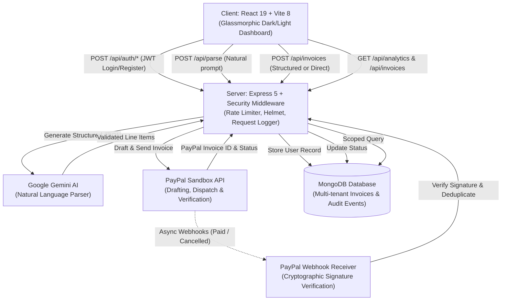

<div align="center">

# ✦ PayNexa

### Next-Generation AI Invoicing System

[](file:///c:/Users/yuvraj/OneDrive/Documents/Desktop/PayNexa/server/src/tests)
[](https://nodejs.org/)
[](https://react.dev/)
[](https://developer.paypal.com/)
[](https://aistudio.google.com/)
[](https://www.mongodb.com/)
[](./LICENSE)

<p align="center">
  <strong>Describe your work in natural English. Let Gemini structure validated invoice line items, and let PayPal handle payment delivery and real-time reconciliation.</strong>
</p>

</div>

---

## 🌟 Highlights & Features

- **✦ Natural Language AI Invoicing**: Describe services in plain English; Google Gemini automatically structures items, prices, quantities, and due dates.
- **✦ Two-Step Preview & Edit**: Review AI-parsed line items, customize prices, add/remove items, and adjust payment terms before committing.
- **✦ Automated PayPal Dispatch**: Dispatches payable, professional invoices directly through the PayPal Sandbox API.
- **✦ Real-Time Webhook Synchronization**: Asynchronous PayPal webhook notifications (`INVOICING.INVOICE.PAID`, `CANCELLED`, `REFUNDED`) update MongoDB invoice statuses automatically with cryptographic signature verification.
- **✦ Enterprise Multi-Tenancy**: Secure user accounts with 12-round bcrypt password hashing, signed 7-day JWT tokens, and strict per-user data isolation.
- **✦ Live Revenue Analytics**: Dashboard stats dynamically calculated from backend database records, with automatic multi-currency breakdowns (USD, EUR, GBP, INR).
- **✦ CSV Export & Full History**: Export complete historical billing records to spreadsheet-compatible CSV with one click.
- **✦ Server-Side Search & Pagination**: Query database records with instant debounced search and status filtering.
- **✦ Production-Grade Security**: Brute-force rate limiting on authentication routes, Zod input schema validation, HTTP security headers via Helmet, and SHA-256 idempotency protection.

---

## 🏗️ Architecture & Flow



---

## 💻 Tech Stack

| Layer | Technologies |
|---|---|
| **Frontend** | React 19, Vite 8, Vanilla Modern CSS Design System, Responsive Mobile Drawer |
| **Backend** | Node.js, Express 5, Helmet, CORS, Express-Rate-Limit, Dotenv |
| **Artificial Intelligence** | Google Gemini Generative AI SDK (`@google/genai`) |
| **Payment Gateway** | PayPal Invoicing REST API v2 (Sandbox Mode) |
| **Database** | MongoDB with Mongoose 9 (Compound Indexes & Audit Collections) |
| **Security & Auth** | JSON Web Tokens (`jsonwebtoken`), Bcrypt, Zod Schema Validation |
| **Testing** | Native Node.js Test Runner (`node:test`, `node:assert`) |

---

## 🚀 Quickstart Guide

### Prerequisites
- Node.js `v20+` and `npm`
- Running MongoDB instance (Local or MongoDB Atlas)
- [PayPal Developer Sandbox Account](https://developer.paypal.com/)
- [Google AI Studio API Key](https://aistudio.google.com/app/apikey)

---

### 1. Clone & Configure Server

```bash
cd server
npm install
```

Copy the example environment configuration:
```bash
cp .env.example .env
```

Update your `.env` with your actual sandbox credentials:
```env
PORT=5000
FRONTEND_URL=http://localhost:5173
PAYPAL_CLIENT_ID=your_paypal_sandbox_client_id
PAYPAL_CLIENT_SECRET=your_paypal_sandbox_client_secret
PAYPAL_BASE_URL=https://api-m.sandbox.paypal.com
PAYPAL_WEBHOOK_ID=your_paypal_webhook_id
GEMINI_API_KEY=your_gemini_api_key
GEMINI_MODEL=gemini-3.5-flash-lite
MONGODB_URI=mongodb://127.0.0.1:27017/paynexa
JWT_SECRET=your_secure_random_jwt_secret_min_32_characters_long
```

Start the backend:
```bash
npm run dev
```

---

### 2. Configure & Run Client

In a separate terminal:
```bash
cd client
npm install
npm run dev
```

Open [http://localhost:5173](http://localhost:5173) in your browser.

---

## 🧪 Testing

PayNexa includes an automated unit and integration test suite covering input validation, duplicate idempotency, line item calculations, currency whitelists, bcrypt hashing, JWT issuance, Zod schemas, config validation, and webhook mapping:

```bash
cd server
npm test
```

```text
ℹ tests 87
ℹ suites 17
ℹ pass 87
ℹ fail 0
```

---

## 📖 API Reference

Detailed API documentation with request and response payloads is available in [`docs/API.md`](./docs/API.md).

| Method | Endpoint | Description | Auth Required |
|---|---|---|---|
| `POST` | `/api/auth/register` | Register new user account | No |
| `POST` | `/api/auth/login` | Login and obtain JWT token | No |
| `GET` | `/api/auth/me` | Fetch authenticated profile | Yes |
| `POST` | `/api/parse` | Parse natural language prompt into line items | Yes |
| `POST` | `/api/invoices` | Generate and dispatch invoice via PayPal | Yes |
| `GET` | `/api/invoices` | Paginated invoice history with status & search | Yes |
| `GET` | `/api/invoices/:id` | Full invoice specification and line items | Yes |
| `POST` | `/api/invoices/sync` | Reconcile statuses with PayPal | Yes |
| `GET` | `/api/invoices/export/csv` | Download complete invoices as CSV | Yes |
| `GET` | `/api/analytics` | Live revenue totals & per-currency stats | Yes |
| `POST` | `/api/webhooks/paypal` | Inbound asynchronous PayPal event receiver | No (Signature Verified) |

---

## 📄 License

This project is licensed under the MIT License — see the [LICENSE](./LICENSE) file for details.
